# AOC 10W1D 초보자 안내서 — 루팅하고 슬립·부팅·충전 화면 바꾸기

> 컴퓨터를 잘 모르는 분도 **복사 → 붙여넣기 → 화면 확인**만으로 따라 할 수 있게 쓴 안내서입니다.
> 원리와 자세한 실측 기록은 [README](./README.md)(DSU·백업)와 [MAGISK_AND_SCREENS](./MAGISK_AND_SCREENS.md)(루팅·화면 구조)에 있습니다.
> 문제가 생기면 [비상 복구(RECOVERY.md)](./RECOVERY.md)를 보세요.

**다 하고 나면**: 태블릿의 **E-Ink 화면 바꾸기** 앱에서 사진을 눌러 아래 5가지 화면을 바꾸거나 순정으로 되돌릴 수 있습니다. 이후로는 PC가 필요 없습니다.

| 슬립 화면 | 종료 화면 | 부팅 로고 | 부팅 애니메이션 | 꺼진 상태 충전 화면 |
|:-:|:-:|:-:|:-:|:-:|
| 전원 버튼을 짧게 눌러 잠들 때 | 전원을 끈 뒤 | 켤 때 처음 2장 | 로고 다음 진행 막대 | 꺼진 채 충전기를 꽂았을 때 |

- 검증 기기: AOC_10W1D, 펌웨어 `WT10S2CN20251225`(Android 11). **다른 기기·다른 펌웨어에는 쓰지 마세요.**
- 걸리는 시간: 처음 한 번 **약 1시간 30분**(대부분 기다리는 시간)
- 이 안내서의 명령은 모두 실기기에서 실행해 확인한 것입니다. 다만 **완전히 순정인 기기로 처음부터 끝까지 이 문서만 보고 따라 하는 시험은 아직 진행 중**입니다(결과는 이 문서에 반영합니다).

> ⚠️ **책임**: 루팅은 기기의 `boot` 파티션에 씁니다. 순서와 해시 확인을 건너뛰지 마세요. 모든 책임은 본인에게 있습니다.

---

## 목차

0. [전체 흐름](#0-전체-흐름)
1. [준비물](#1-준비물)
2. [개발자 옵션과 USB 디버깅 켜기 (비밀번호 2204)](#2-개발자-옵션과-usb-디버깅-켜기-비밀번호-2204)
3. [PC와 연결 확인](#3-pc와-연결-확인)
4. [진단 GSI로 임시 부팅하고 순정 백업 받기](#4-진단-gsi로-임시-부팅하고-순정-백업-받기)
5. [Magisk 루팅](#5-magisk-루팅)
6. [화면 바꾸기 앱 설치와 루트 허용](#6-화면-바꾸기-앱-설치와-루트-허용)
7. [테마 그림 넣고 화면 바꾸기](#7-테마-그림-넣고-화면-바꾸기)
8. [순정으로 되돌리기](#8-순정으로-되돌리기)
9. [자주 묻는 질문](#9-자주-묻는-질문)
10. [English summary](#10-english-summary)

---

## 0. 전체 흐름

```
[2] 개발자 옵션 켜기 ─ [3] PC 연결 ─ [4] 임시 시스템(DSU)으로 켜서 순정 백업 ─ [5] Magisk 루팅
                                                                                  │
                         [8] 순정으로 되돌리기 ◀── 언제든 ── [7] 그림 고르기 ◀── [6] 앱 설치
```

왜 4단계가 필요한가요? 이 기기는 제조사가 펌웨어 파일을 공개하지 않습니다. 루팅하려면 내 기기의 **순정 `boot` 파일**이 있어야 하는데, 이를 꺼낼 방법이 "임시 시스템(진단 GSI)으로 한 번 켜서 복사하는 것"뿐입니다. 이때 받은 백업은 기기가 고장 났을 때 되살릴 유일한 원본이기도 합니다.

---

## 1. 준비물

| 준비물 | 받는 곳 | 비고 |
|:---|:---|:---|
| Windows 10/11 PC | | 저장 공간 **10GB 이상** 여유 |
| **데이터용** USB-C 케이블 | | 충전 전용 케이블은 안 됨. PC 본체 뒤쪽 USB 포트 권장 |
| **platform-tools** (adb, fastboot) | [Android 공식 페이지](https://developer.android.com/tools/releases/platform-tools) → "SDK Platform-Tools for Windows 다운로드" | 압축을 풀어 **`C:\platform-tools`** 폴더가 되게 둡니다 |
| **Google USB 드라이버** | [Android 공식 페이지](https://developer.android.com/studio/run/win-usb) → zip 다운로드 | 5단계(fastboot)에서 기기가 안 보일 때만 설치. 압축만 풀어 두기 |
| **Magisk 30.7** | [Magisk v30.7 Releases](https://github.com/topjohnwu/Magisk/releases/tag/v30.7) → `Magisk-v30.7.apk` | **30.7을 쓰세요.** 다른 버전은 검증하지 않았습니다 |
| 진단 GSI · 앱 · 테마 그림 · 스크립트 | 이 저장소 [Releases(최신)](https://github.com/zlkiki/AOC-10W1D-DSU-Root/releases/latest) | 아래 표의 파일 전부 |
| 태블릿 상태 | | 배터리 **60% 이상**, 내부 저장 공간 **30GB 이상** 여유 |

**Releases에서 받을 파일** (모두 `C:\platform-tools`에 넣으세요)

| 파일 | 크기 | 용도 |
|:---|---:|:---|
| `aoc_dsu_diag_v2_phh-v313-vanilla.img.gz` | 약 930MB | 4단계 임시 시스템(진단 GSI) |
| `EinkScreens-v1.2.apk` | 약 57KB | 6단계 화면 바꾸기 앱 |
| `EinkThemes.zip` | 약 0.5MB | 7단계 테마 그림 9종×5장 |
| `aoc_backup_partitions.sh`, `aoc_magisk_patch.sh` | 몇 KB | 4·5단계 스크립트(저장소 [`tools/`](./tools/)에도 있음) |
| `SHA256SUMS.txt` | | 내려받은 파일이 온전한지 확인 |

### 1.1. 명령 창(PowerShell) 여는 법

1. 파일 탐색기에서 `C:\platform-tools` 폴더를 엽니다.
2. 위쪽 **주소 표시줄**을 누르고 `powershell`이라고 입력한 뒤 Enter.
3. 파란(또는 검은) 창이 뜨고 `PS C:\platform-tools>`가 보이면 준비 완료입니다.

이 문서의 회색 상자 명령은 이 창에 **한 줄씩 복사해 붙여넣고 Enter**를 누르면 됩니다. `#` 뒤는 설명이라 함께 붙여넣어도 괜찮습니다.

### 1.2. 내려받은 파일 확인

```powershell
Get-FileHash aoc_dsu_diag_v2_phh-v313-vanilla.img.gz    # 결과의 Hash 값을
Get-Content SHA256SUMS.txt                              # 이 목록의 같은 이름 값과 비교 (대소문자는 무시)
```

- ✅ 정상: 두 값이 같음 (진단 GSI는 `D591374C…4385`)
- ❌ 다르면: 내려받기가 깨진 것입니다. 지우고 다시 받으세요.

---

## 2. 개발자 옵션과 USB 디버깅 켜기 (비밀번호 2204)

이 기기는 일반 안드로이드처럼 "빌드 번호 7번"만으로는 안 되고, **비밀번호 창을 두 번** 거칩니다.

| 순서 | 할 일 | 그림 |
|:-:|:---|:-:|
| ① | 홈 → **Settings** → 왼쪽 **About Device** → 오른쪽 맨 위 제목 **"About Device"** 글자를 빠르게 7~8번 탭 | 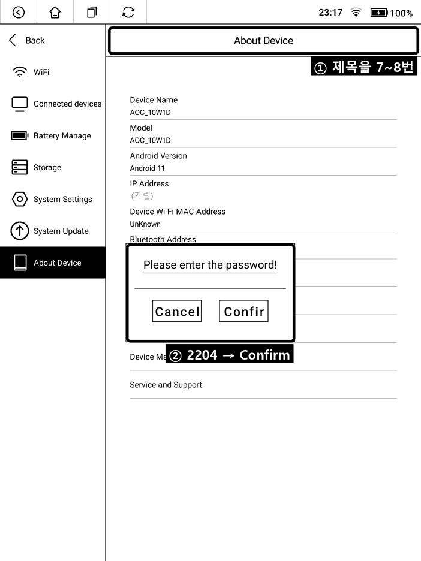 |
| ② | "Please enter the password!" 창 → **2204** → **Confirm** | (같은 그림) |
| ③ | Android 설정 화면이 열림 → 맨 위 **AOC_10W1D** 상자를 누름 | 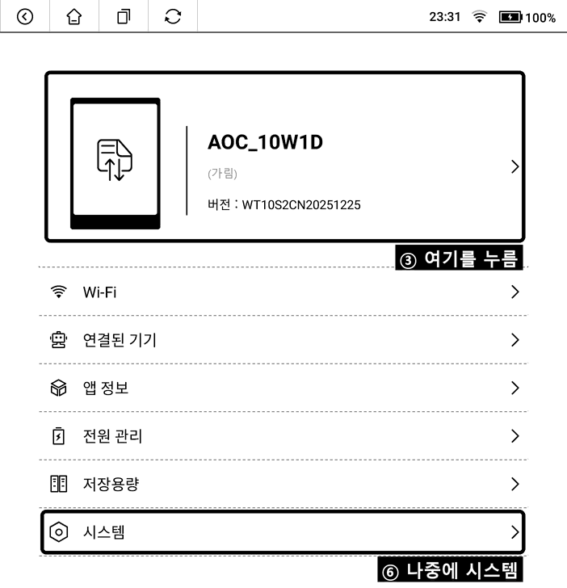 |
| ④ | **태블릿 정보** → 맨 아래 **빌드 번호**를 7번 탭 → 비밀번호 창에 **2204** → 확인 | 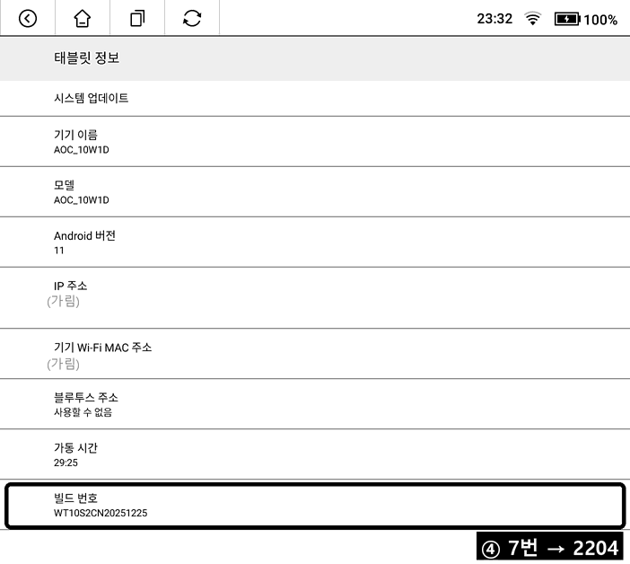 |
| ⑤ | "**개발자가 되셨습니다**" 알림이 뜸 | |
| ⑥⑦ | 뒤로 → **시스템** → **개발자 옵션** | 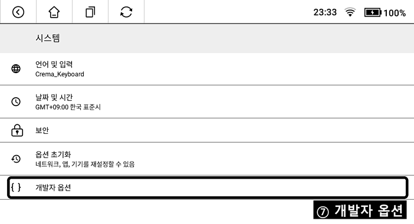 |
| ⑧ | 아래로 내려 **USB 디버깅** 켜기 → 확인 창이 뜨면 확인 | 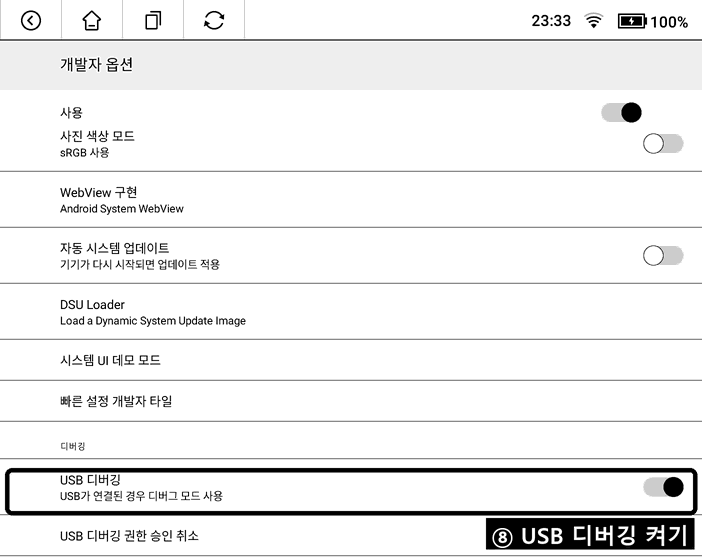 |

- ✅ 정상: ⑤에서 "개발자가 되셨습니다"가 뜨고, ⑦에 **개발자 옵션**이 보입니다.
- ❌ ①에서 창이 안 뜸: 제목 글자("About Device") 위를 더 빠르게 눌러 보세요. 아래쪽 "Build Number" 줄을 누르는 것이 아닙니다.
- ❌ ⑦에 개발자 옵션이 없음: ④에서 **두 번째** 비밀번호 창에 2204를 넣었는지 확인하세요. ②의 첫 번째 창은 설정 화면을 여는 역할만 합니다.
- 참고: 다음부터는 ①~②로 Android 설정을 열고 바로 ⑥으로 가면 됩니다.

---

## 3. PC와 연결 확인

1. 태블릿을 USB 케이블로 PC에 연결합니다.
2. 태블릿에 **"USB 환경설정"** 창이 뜨면 **파일 전송**을 고릅니다(7단계에서 그림을 복사할 때 필요). 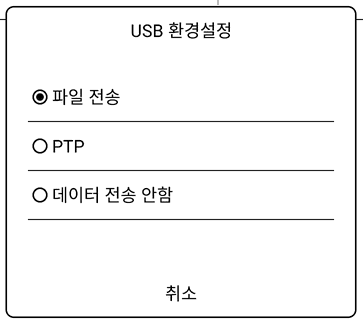
3. 태블릿에 **"USB 디버깅을 허용하시겠습니까?"** 창이 뜨면 **"이 컴퓨터에서 항상 허용"**을 체크하고 **허용**. (E-Ink라 창이 늦게 그려질 수 있습니다. 한 번 허용한 PC에서는 다시 뜨지 않습니다.)

```powershell
.\adb devices
```

- ✅ 정상: `List of devices attached` 아래에 `영문숫자    device` 한 줄
- ❌ `unauthorized`: 태블릿 화면의 허용 창을 확인하세요. 안 보이면 케이블을 뽑았다 다시 꽂으세요.
- ❌ 아무것도 안 나옴: ① 다른 케이블·다른 USB 포트(본체 뒤쪽) ② USB 디버깅이 켜져 있는지 확인
- ❌ `'.\adb'은(는) ... 인식되지 않습니다`: 명령 창이 `C:\platform-tools`에서 열린 것이 아닙니다. [1.1](#11-명령-창powershell-여는-법)을 다시 하세요.

기기 조건도 확인합니다(읽기만 합니다).

```powershell
.\adb shell getprop ro.boot.flash.locked        # 0 이어야 함 (부트로더 언락. 이 기기는 출고 때부터 0)
.\adb shell getprop ro.build.display.id         # WT10S2CN20251225 가 들어 있어야 함
.\adb shell df -h /data                          # Avail(여유)이 30G 이상
```

- ❌ `flash.locked`가 `1`: 이 안내서로는 진행할 수 없습니다.
- ❌ 펌웨어가 다름: 진행은 될 수도 있지만 검증하지 않았습니다. 5단계의 해시 비교가 맞지 않으면 멈추세요.

---

## 4. 진단 GSI로 임시 부팅하고 순정 백업 받기

DSU(Dynamic System Updates)라는 안드로이드 공식 기능으로, 내부 저장소의 파일에 임시 시스템을 깔아 **한 번만** 그걸로 켭니다. 기기의 시스템·부트 파티션에는 쓰지 않고, 다음에 켜면 자동으로 순정으로 돌아옵니다. ([원리](./README.md#1-이-가이드가-필요한-이유))

### 4.1. 설치 (약 10분)

```powershell
.\adb push aoc_dsu_diag_v2_phh-v313-vanilla.img.gz /storage/emulated/0/Download/
.\adb shell setprop persist.sys.fflag.override.settings_dynamic_system true
.\adb shell am start-activity -n com.android.dynsystem/com.android.dynsystem.VerificationActivity -a android.os.image.action.START_INSTALL -d file:///storage/emulated/0/Download/aoc_dsu_diag_v2_phh-v313-vanilla.img.gz --el KEY_SYSTEM_SIZE 2325557248 --el KEY_USERDATA_SIZE 17179869184
```

마지막 명령은 길지만 **한 줄**입니다. 그대로 복사하세요. `KEY_SYSTEM_SIZE` 값(`2325557248`)은 Releases 설명에 적힌 값과 같아야 합니다(다르면 Releases의 값으로 바꾸세요).

- 태블릿에 확인 창이 뜨면 **확인**. (화면 잠금이 없으면 창 없이 바로 시작합니다.)
- 알림창에 설치 진행률이 보입니다. **6~8분** 기다립니다.
- ✅ 정상: 알림 **"동적 시스템이 준비되었습니다 … 다시 시작하세요"** 와 `[삭제]` `[다시 시작]` 버튼
- ❌ 버튼을 눌러도 반응 없음: 두 번째 줄(`setprop …`)을 빠뜨린 것입니다. 다시 실행하세요.
- ❌ 공간 부족: 내부 저장 공간 30GB 이상을 비우세요.

### 4.2. 임시 시스템으로 다시 시작 (약 3분)

1. 알림의 **[다시 시작]**을 누릅니다. ⚠️ 전원 메뉴의 "다시 시작"을 쓰면 안 됩니다.
2. **화면이 부팅 로고에서 멈춘 것처럼 보입니다. 정상입니다.** 임시 시스템은 E-Ink 화면을 그리지 못하고, E-Ink는 마지막 그림을 그대로 둡니다. 화면은 신경 쓰지 말고 PC로 확인합니다.
3. **3분** 기다린 뒤:

```powershell
.\adb devices
```

- ✅ 정상: 기기 한 줄이 `device`로 보임 (실측: [다시 시작] 후 약 2분 40초)
- ❌ 4분이 지나도 안 보임: USB 케이블을 뽑았다 다시 꽂고 다시 확인하세요.
- ❌ 계속 안 보이거나 그만두고 싶음: 전원 버튼을 **10초** 눌러 끄고 다시 켜면 순정으로 켜집니다. 4.1부터 다시 할 수 있습니다.

### 4.3. 관리자(root) 셸로 전환 — 8분 안에

진단 GSI는 안전장치로 **8분 뒤 스스로 다시 시작해 순정으로 돌아가게** 되어 있습니다. 백업하려면 이 타이머를 끕니다.

```powershell
.\adb root
.\adb wait-for-device
.\adb shell touch /data/local/tmp/dsudiag_stop       # 8분 자동 재시작 취소
.\adb shell stop                                     # 임시 시스템의 화면 프로그램 멈추기(백업에 불필요)
.\adb shell getprop ro.gsid.image_running            # 1 이 나와야 함
```

- ✅ 정상: `adb root` → `restarting adbd as root`, 마지막 줄 `1`
- ❌ 도중에 기기가 다시 시작됨: 8분이 지난 것입니다. 순정으로 켜지면 4.1의 `am start-activity`부터 다시 하세요(이미지는 재사용).

### 4.4. 전체 백업 (약 5분, 약 4.2GB)

`userdata`(사용자 데이터)를 뺀 모든 파티션을 복사하고, **원본과 복사본의 SHA-256 해시가 같은지** 하나씩 확인합니다. 읽기만 합니다.

```powershell
.\adb push aoc_backup_partitions.sh /data/local/tmp/
.\adb shell sh /data/local/tmp/aoc_backup_partitions.sh
```

✅ 정상 (약 2분):

```
partitions: backup boot cache dtbo logo metadata misc mmcblk2boot0 mmcblk2boot1 recovery security super trust uboot vbmeta waveform
(1/16) backup         ok  384 MB
(2/16) boot           ok  64 MB
...
(12/16) super          ok  3112 MB
...
gpt_head       ok
DONE: /data/local/tmp/aoc_backup (4116 MB). Now on the PC: adb pull /data/local/tmp/aoc_backup
```

PC로 가져오고(약 2분), PC에서 한 번 더 확인합니다.

```powershell
.\adb pull /data/local/tmp/aoc_backup .
Get-Content aoc_backup\SHA256SUMS.txt | ForEach-Object { $h, $f = $_ -split ' \*'; if ((Get-FileHash "aoc_backup\$f").Hash -eq $h) { "OK    $f" } else { "FAIL  $f" } }
```

- ✅ 정상: 17줄 모두 `OK`
- ❌ `HASH MISMATCH`·`FAIL`: 해당 명령을 다시 실행하세요. 계속되면 멈추고 [이슈](https://github.com/zlkiki/AOC-10W1D-DSU-Root/issues)에 출력 내용을 남겨 주세요.

순정 boot의 해시를 확인합니다.

```powershell
Get-FileHash aoc_backup\boot.img
```

| 파일 | 검증 기기(`WT10S2CN20251225`) 값 |
|:---|:---|
| `boot.img`(순정) | `190133077A0E8148E3D4C96B39677423C93D2FFE5FF54103743A5673A32A9EB6` |

- 같으면 검증 기기와 **완전히 같은 펌웨어**입니다.
- 다르면 펌웨어가 다른 것입니다. 5단계를 할 수는 있지만 검증된 조합이 아닙니다.

> 📦 **`aoc_backup` 폴더를 꼭 두 곳 이상(외장 USB, 클라우드 등)에 복사해 두세요.** 이 기기는 제조사 복구 파일이 없어서, 이 백업이 유일한 원본입니다. `waveform.img`는 이 기기 패널 전용 보정값이라 **다른 사람과 나누거나 다른 기기에 쓰면 안 됩니다.**

### 4.5. 순정으로 돌아오고 임시 시스템 지우기

```powershell
.\adb reboot
```

순정 화면이 뜨면(1~2분) 아래를 실행합니다. `adb devices`에 안 보이면 **USB 케이블을 뽑았다 다시 꽂으세요**(이 기기에서 자주 생깁니다).

```powershell
.\adb shell getprop ro.build.type                    # user  (순정으로 돌아옴)
.\adb shell gsi_tool wipe                            # Live image install successfully removed.
.\adb shell setprop persist.sys.fflag.override.settings_dynamic_system false
.\adb shell am force-stop com.android.dynsystem
.\adb shell rm /storage/emulated/0/Download/aoc_dsu_diag_v2_phh-v313-vanilla.img.gz
```

- ✅ 정상: 임시 시스템 공간(약 18GB)이 돌아오고, 기기는 4단계 전과 같습니다.

---

## 5. Magisk 루팅

순정 `boot.img`에 Magisk를 넣은 파일을 **태블릿 안에서** 만들고(Python 불필요), PC에서 `boot`에 씁니다.

### 5.1. Magisk 앱 설치와 패치 파일 만들기 (약 1분)

```powershell
.\adb install Magisk-v30.7.apk
.\adb shell mkdir -p /data/local/tmp/mk
.\adb push Magisk-v30.7.apk aoc_backup\boot.img aoc_magisk_patch.sh /data/local/tmp/mk/
.\adb shell sh /data/local/tmp/mk/aoc_magisk_patch.sh
```

✅ 정상:

```
[1/4] Magisk-v30.7.apk, boot.img 67108864 bytes, sha256 190133077a0e…
[2/4] Magisk kit ready
[3/4] patched (log: /data/local/tmp/mk/patch.log)
      kernel: same
      dtb: same
      second: same
      ramdisk: changed (Magisk added)
[4/4] OK  magisk_patched_boot.img sha256 4f8136e23e79ce4b044177d6b65a42d26cd06a97073e767557222dd4445148f1
```

| 파일 | 검증 기기 값 |
|:---|:---|
| `magisk_patched_boot.img` (순정 boot `190133…` + Magisk 30.7) | `4f8136e23e79ce4b044177d6b65a42d26cd06a97073e767557222dd4445148f1` |

- **순정 boot가 `190133…`였다면 결과도 반드시 `4f8136e2…`여야 합니다.** 이는 검증 기기에서 실제로 쓰고 켜 본 파일과 바이트 단위로 같다는 뜻입니다. 다르면 쓰지 말고 멈추세요.
- ❌ `ERROR: …`: 메시지에 적힌 파일이 `/data/local/tmp/mk`에 있는지 확인하고 `push` 줄부터 다시 하세요.
- 왜 Magisk 앱의 "파일 선택 후 패치"를 쓰지 않나요? 이 펌웨어에는 기본 파일 선택기(DocumentsUI)가 없어서 파일을 고를 수 없습니다. 스크립트는 Magisk 앱이 하는 것과 같은 과정을 같은 설정으로 실행합니다([자세히](./MAGISK_AND_SCREENS.md#31-패치-기기-화면-조작-없이-cli)).

```powershell
.\adb pull /data/local/tmp/mk/magisk_patched_boot.img
Get-FileHash magisk_patched_boot.img                 # 4F8136E2… 인지 한 번 더
```

### 5.2. boot에 쓰기 (약 2분)

```powershell
.\adb reboot fastboot
```

20초쯤 기다린 뒤:

```powershell
.\fastboot devices
```

- ✅ 정상: `영문숫자    fastboot`
- ❌ 아무것도 안 나옴 → **Google USB 드라이버 설치**:
  1. 시작 버튼 오른쪽 클릭 → **장치 관리자**
  2. 노란 느낌표가 붙은 **Android** (또는 "기타 장치") 항목 오른쪽 클릭 → **드라이버 업데이트**
  3. **내 컴퓨터에서 드라이버 찾아보기** → 압축을 푼 `usb_driver` 폴더 선택 → 다음
  4. 목록이 나오면 **Android Bootloader Interface** → 설치 후 `.\fastboot devices` 다시 확인

나오면 씁니다. **파일 이름을 정확히** 확인하세요.

```powershell
.\fastboot flash boot magisk_patched_boot.img
.\fastboot reboot
```

- ✅ 정상: `Sending 'boot' … OKAY`, `Writing 'boot' … OKAY`, `Finished`. 1~2분 뒤 평소처럼 켜짐
- ❌ `Partition not found`·`FAILED`: 아무것도 쓰이지 않은 것입니다. `.\fastboot reboot`로 다시 켜고 원인을 확인하세요.
- ❌ 켜지지 않고 5분 넘게 로고에 멈춤: [RECOVERY.md](./RECOVERY.md)를 보세요.

### 5.3. 루팅 확인과 셸 허용

켜진 뒤 `adb devices`에 안 보이면 케이블을 다시 꽂고:

```powershell
.\adb shell magisk -v                                # 30.7:MAGISK:R
.\adb shell su -c id                                 # 태블릿에 허용 창이 뜸 → 빨리 [허용]
```

- ✅ 정상: `uid=0(root)` 가 나옴
- ❌ `Permission denied`: E-Ink는 화면이 느려서 허용 창이 10초 안에 안 눌리면 **자동으로 '거부'가 저장**됩니다. 태블릿에서 **Magisk 앱 → 아래 [슈퍼유저] 탭 → "[SharedUID] 셸" 스위치 켜기** → 명령 다시 실행. 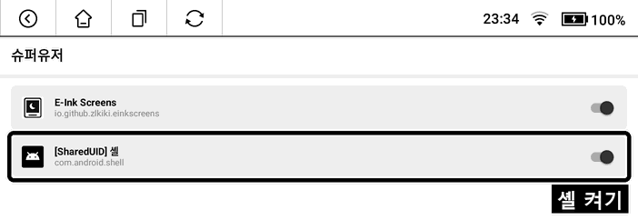
- Magisk 앱을 처음 열 때 "추가 설정이 필요합니다"가 나오면 [확인]을 누르세요(재시작됨).
- Magisk 앱이 **앱 업데이트**를 권해도 지금은 누르지 마세요(30.7로 검증했습니다).

---

## 6. 화면 바꾸기 앱 설치와 루트 허용

```powershell
.\adb install EinkScreens-v1.2.apk
```

1. 태블릿 **Apps**에서 **E-Ink Screens**(E-Ink 화면 바꾸기)를 엽니다.
2. Magisk **슈퍼유저 요청** 창이 뜨면 바로 **허용**.
3. ✅ 정상: 상단에 "**준비 완료. 바꿀 화면의 [사진 고르기]를 누르세요.**" 와 지금 화면들의 미리보기 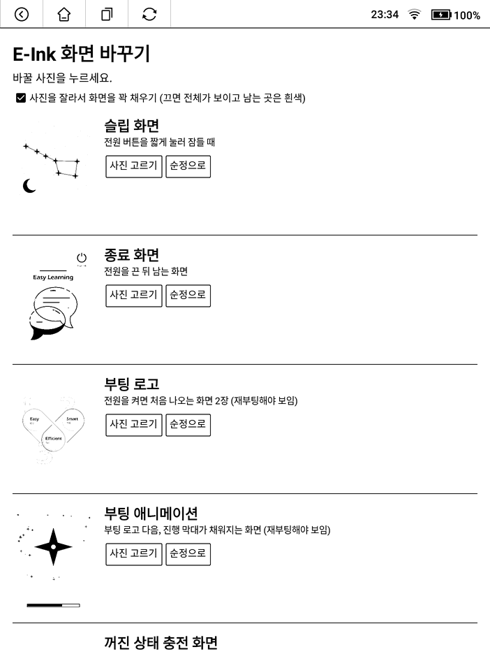

- ❌ "루트 권한이 없습니다…": 허용 창을 놓친 것입니다. **Magisk 앱 → [슈퍼유저] → E-Ink Screens 스위치 켜기** → 화면 바꾸기 앱을 완전히 닫았다 다시 실행.
- 앱은 처음 실행할 때 **원래 logo 파티션을 `/sdcard/EinkScreens/backup/logo_original.img`에 백업**합니다. PC에도 받아 두고, 4단계 백업과 같은지 확인하세요.

```powershell
.\adb pull /sdcard/EinkScreens/backup/logo_original.img
Get-FileHash logo_original.img, aoc_backup\logo.img  # 두 Hash가 같아야 함
```

---

## 7. 테마 그림 넣고 화면 바꾸기

### 7.1. 그림 넣기

`EinkThemes.zip`에는 글자 없는 E-Ink용 그림 9종(달의 위상, 종이와 잉크, 미니멀 기하, 모래시계, 새싹, 산과 해돋이, 바둑, 북두칠성, 커피 한 잔)이 테마마다 5장씩 들어 있습니다.


**방법 A (탐색기)**: zip을 풀고 → 탐색기 왼쪽 **내 PC → AOC_10W1D → 내부 공유 저장공간 → Pictures**에 `EinkThemes` 폴더를 통째로 끌어다 놓습니다. (AOC_10W1D가 안 보이면 태블릿의 "USB 환경설정"에서 **파일 전송**을 고르세요.)

**방법 B (명령)**:

```powershell
Expand-Archive EinkThemes.zip -DestinationPath .
.\adb push EinkThemes /sdcard/Pictures/EinkThemes
```

내 사진을 쓰려면 `Pictures`, `DCIM`, `Download` 폴더 아래 아무 곳에나 넣으면 됩니다(png·jpg·webp·bmp). 세로 1404×1872에 가까울수록 잘 맞고, 흑백 16단계로 바뀝니다.

### 7.2. 바꾸기

| 순서 | 할 일 | 그림 |
|:-:|:---|:-:|
| 1 | 바꿀 화면의 **[사진 고르기]** | |
| 2 | "사진 폴더" 창에서 폴더 선택 (예: `Pictures/EinkThemes/06_산과해돋이 (5)`) | 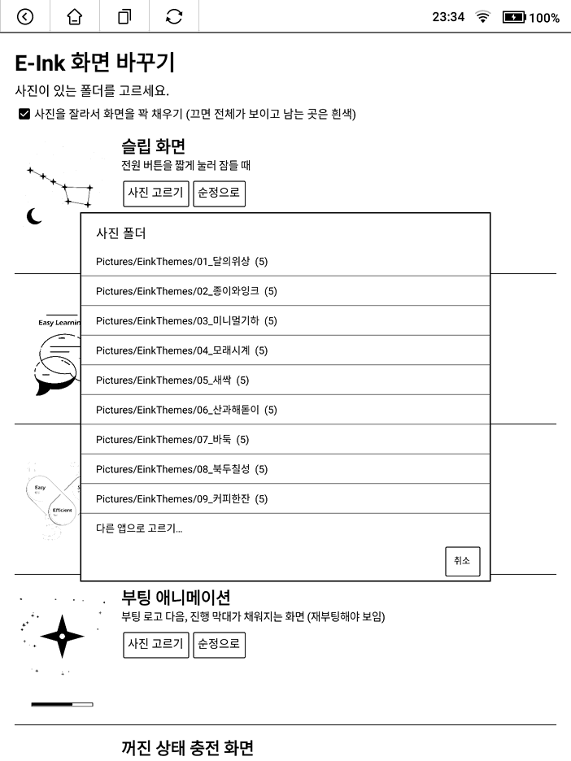 |
| 3 | 사진을 누르면 **바로 적용** — 슬립 화면이면 `1_슬립.png`, 종료면 `2_종료.png` … | 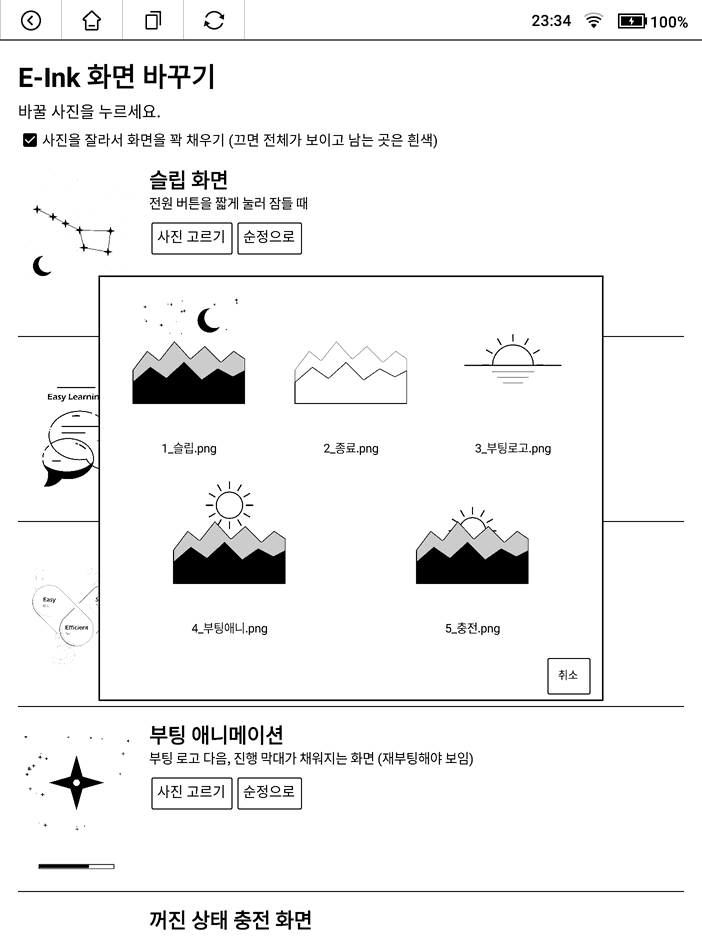 |
| 4 | 확인: 슬립은 아래 **[슬립 해보기]**, 부팅 로고·부팅 애니메이션은 **[재부팅]**, 꺼진 상태 충전은 전원을 끄고 충전기를 꽂아 봄 | 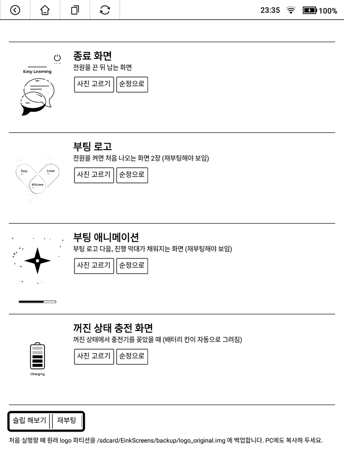 |

- ✅ 정상: 상태 줄에 "**슬립 화면을 바꿨습니다. [슬립 해보기]로 확인하세요.**" 같은 문구
- 테마 그림의 아래쪽이 비어 있는 것은 정상입니다. 부팅 애니메이션은 그 자리에 **진행 막대**를, 충전 화면은 **배터리 칸**을 앱이 그려 넣습니다.
- "사진을 잘라서 화면을 꽉 채우기"를 끄면 사진 전체가 보이고 남는 곳은 흰색이 됩니다.
- ❌ "사진을 찾지 못했습니다": 7.1을 다시 확인하세요(`Pictures` 아래에 폴더가 있어야 함).
- ❌ 맨 아래 "다른 앱으로 고르기…"에서 **순정 갤러리를 고르면 갤러리가 종료됩니다**(펌웨어 문제). 앱 안의 폴더 목록을 쓰세요.
- 부팅 애니메이션은 Magisk 모듈로 들어갑니다. 바꾼 뒤에는 **재부팅해야** 보입니다.

---

## 8. 순정으로 되돌리기

### 8.1. 화면만 되돌리기

앱에서 각 화면의 **[순정으로]**를 누릅니다. 부팅 로고·충전 화면은 6단계에서 앱이 만든 백업으로, 슬립·종료·부팅 애니메이션은 바꾼 파일을 지워서 되돌립니다. 부팅 애니메이션은 **재부팅 후** 순정이 됩니다.

### 8.2. 루팅까지 완전히 되돌리기

순서가 중요합니다. **화면을 먼저 되돌리고**(루트가 필요하므로), 그다음 boot를 되돌립니다.

1. 앱에서 5가지 화면 모두 **[순정으로]** → **[재부팅]** (재부팅해야 부팅 애니메이션 모듈이 지워집니다)
2. PC에서 순정 boot를 다시 씁니다.

```powershell
.\adb reboot fastboot
.\fastboot flash boot aoc_backup\boot.img
.\fastboot reboot
```

3. 켜진 뒤 앱 두 개를 지웁니다.

```powershell
.\adb uninstall io.github.zlkiki.einkscreens
.\adb uninstall com.topjohnwu.magisk
```

- ✅ 정상: `fastboot`가 `OKAY`, 켜진 뒤 `.\adb shell su -c id`가 실패(= 루트 없음)
- 참고: Magisk가 쓰던 `/data/adb` 폴더는 남지만, 루트가 없으니 쓰이지 않습니다.
- 원하면 설정 → 시스템 → 개발자 옵션 → 맨 위 스위치를 꺼서 개발자 옵션도 끌 수 있습니다(USB 디버깅도 함께 꺼짐).

> Magisk 앱의 [Magisk 제거 → 완전히 제거]는 Magisk가 직접 boot를 고친 경우에만 순정 백업이 있습니다. 이 안내서처럼 PC에서 쓴 경우에는 위 `fastboot` 방법을 쓰세요.

---

## 9. 자주 묻는 질문

| 질문 | 답 |
|:---|:---|
| 다시 시작하면 PC에서 기기가 안 보여요 | 이 기기에서 흔합니다. **USB 케이블을 뽑았다 다시 꽂으세요.** |
| 전원 버튼을 길게 눌렀더니 꺼졌어요 | 이 기기는 8~10초 누르면 전원이 끊깁니다. 다시 누르면 켜집니다. |
| 충전 중 슬립 화면이 따로 있나요? | 이 펌웨어는 충전 여부와 관계없이 슬립 화면 1장을 씁니다. 배터리 칸이 있는 충전 화면은 **꺼진 상태에서 충전할 때**만 나옵니다. ([자세히](./MAGISK_AND_SCREENS.md#8-알려진-한계와-함정)) |
| 순정 갤러리의 "대기 화면으로 지정"은요? | 이 펌웨어에서는 화면에 반영되지 않습니다(다른 경로에 씀). |
| 펌웨어 업데이트가 오면? | 업데이트가 boot를 바꾸면 루팅이 풀립니다. 이 안내서는 `WT10S2CN20251225`만 검증했습니다. |
| 백업은 어디에 쓰나요? | 고장 났을 때 [RECOVERY.md](./RECOVERY.md)의 방법으로 되살릴 때 씁니다. |

---

## 10. English summary

A copy-and-paste guide for **AOC_10W1D** (RK3566, Android 11, firmware `WT10S2CN20251225`, bootloader unlocked from the factory). Run the commands in PowerShell from `C:\platform-tools`. All files are in the [latest release](https://github.com/zlkiki/AOC-10W1D-DSU-Root/releases/latest).

1. **Developer options**: Settings → About Device → tap the **title "About Device"** 7–8 times → password **2204** → Android Settings opens → tap the **AOC_10W1D** header → About tablet → tap **Build number** 7 times → password **2204** → "You are now a developer" → System → Developer options → **USB debugging**.
2. **Temporary DSU boot + full backup** (no system partition is written): push the diagnostic GSI, `setprop persist.sys.fflag.override.settings_dynamic_system true`, start the install with `KEY_SYSTEM_SIZE 2325557248` and `KEY_USERDATA_SIZE 17179869184`, tap **Restart** in the notification, wait ~3 min (the E-Ink screen stays frozen on the logo; that is expected), `adb root`, `touch /data/local/tmp/dsudiag_stop`, `stop`, then `sh tools/aoc_backup_partitions.sh` (every partition except userdata, SHA-256 checked twice) and `adb pull`. Keep the backup in two places. `adb reboot` returns to stock; `gsi_tool wipe`.
3. **Magisk 30.7**: `tools/aoc_magisk_patch.sh` patches the stock boot on the device (this firmware has no DocumentsUI, so the app's "Select and Patch a File" has no picker). Stock boot `190133…` must give `4f8136e2…`, the exact image verified on the test device. `adb reboot fastboot` → `fastboot flash boot magisk_patched_boot.img`. E-Ink makes the first su prompt time out and Magisk saves *deny*; enable Shell / the app in Magisk → Superuser.
4. **E-Ink Screens app 1.2**: pick a folder and a photo for sleep, power-off, boot logo, boot animation and off-charging screens, or tap **Stock** to revert. The app backs up the logo partition on first run. Theme pack: 9 text-free themes × 5 images.
5. **Full revert**: Stock for all five screens → reboot → `fastboot flash boot` the stock boot → uninstall both apps.

Emergency recovery (MaskROM + RKDevTool): [RECOVERY.md](./RECOVERY.md).
